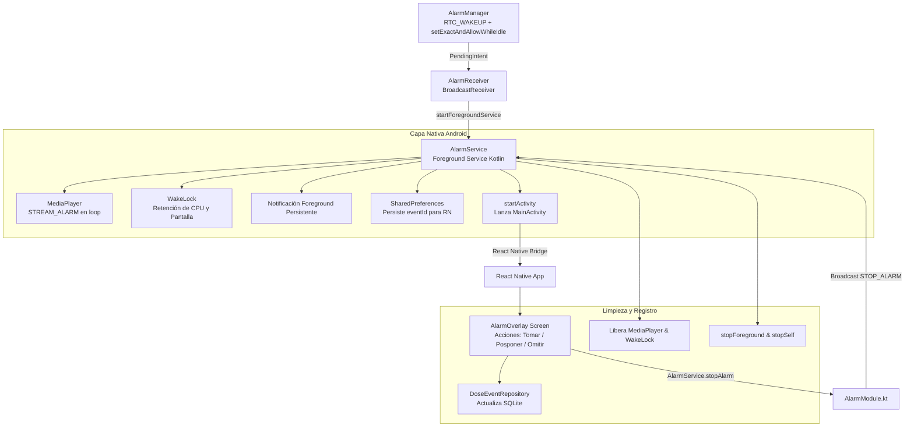

# MedReminder (Pastillero Virtual) 💊⏰

[](https://reactnative.dev)
[](https://www.typescriptlang.org/)
[](https://www.android.com/)
[](https://www.sqlite.org/)
[](https://github.com/pmndrs/zustand)
[](https://callstack.github.io/react-native-paper/)

**MedReminder** es una aplicación móvil *offline-first* desarrollada con **React Native** y **TypeScript**, orientada a la gestión integral de tratamientos médicos, adherencia del paciente y recordatorios de medicación de alta fiabilidad.

A diferencia de los recordatorios estándar o alarmas convencionales que suelen ser silenciadas o congeladas por los modos de ahorro de energía del sistema operativo, **MedReminder implementa un motor de alarmas nativas Android de grado médico** capaz de sonar y despertar el dispositivo incluso bajo restricciones agresivas de *Doze Mode* o en procesos en segundo plano.

---

## 📌 Tabla de Contenidos

- [El Problema y la Solución](#-el-problema-y-la-solución)
- [Características Principales](#-características-principales)
- [Arquitectura de Alarmas Nativas](#-arquitectura-de-alarmas-nativas)
- [Stack Tecnológico](#-stack-tecnológico)
- [Estructura del Proyecto](#-estructura-del-proyecto)
- [Requisitos Previos](#-requisitos-previos)
- [Instalación y Puesta en Marcha](#-instalación-y-puesta-en-marcha)
- [Scripts Disponibles](#-scripts-disponibles)
- [Documentación Adicional](#-documentación-adicional)
- [Licencia](#-licencia)

---

## 💡 El Problema y la Solución

### El Problema
- **Olvidos frecuentes:** Dudas recurrentes del estilo *"¿tomé mi pastilla de las 8:00 o no?"*.
- **Alarmas silenciadas en segundo plano:** Los sistemas operativos modernos (particularmente Android 13/14+ y fabricantes como Xiaomi, Samsung o Huawei) aplican mecanismos agresivos de ahorro de batería (*Doze Mode*, congelamiento de procesos en background). Las notificaciones estándar de JavaScript o apps no especializadas a menudo no suenan a tiempo.
- **Falta de registro histórico:** Las alarmas de reloj solo avisan, pero no registran cumplimiento, omisiones ni estadísticas de adherencia al tratamiento.

### La Solución
- **Sistema de Adherencia Médica:** Permite confirmar tomas con un toque, posponerlas con re-notificación o registrarlas como omitidas.
- **Motor Nativo en Kotlin:** Garantiza la ejecución de alarmas a la hora exacta mediante `AlarmManager.setExactAndAllowWhileIdle()` y un `Foreground Service` que reproduce audio nativo en el canal de alarmas (`STREAM_ALARM`) con retención de CPU (`WakeLock`).
- **Base de Datos Local Offline:** Todos los datos se almacenan en un SQLite local cifrable sin depender de conexión a internet.

---

## ✨ Características Principales

- 💊 **Gestión de Medicamentos y Tratamientos:**
  - Creación con asistente guiado (*Wizard Modal* de pasos progresivos).
  - Configuración de posología: dosis, unidades (mg, ml, gotas, comprimidos, etc.), notas y color distintivo.
  - Tratamientos temporales (con fecha de fin) o crónicos (indefinidos).
  - Frecuencias configurables: intervalos regulares (cada X horas), horarios fijos o tomas específicas.

- 🔔 **Motor de Alarmas Nativas Ininterrumpibles (Android):**
  - Despertar del procesador mediante `RTC_WAKEUP` y `WakeLock`.
  - Disparo garantizado con `AlarmManager` independientemente de que la app esté cerrada.
  - Servicio en primer plano (*Foreground Service*) en Kotlin con notificación obligatoria del sistema.
  - Pantalla completa (*Full Screen Intent*) que despliega el modal interactivo `AlarmOverlay` incluso con pantalla bloqueada.
  - Receptor de arranque (`BootReceiver`) que reprograma automáticamente todas las alarmas tras reiniciar el dispositivo.

- 📅 **Calendario y Métricas de Adherencia:**
  - Registro de estados de dosis: `TOMADA` (verde), `PERDIDA` (rojo), `OMITIDA` (naranja) y `PENDIENTE` (azul).
  - Vista de calendario interactivo para consultar el cumplimiento día a día o mes a mes.
  - Resumen de progreso de dosis tomadas durante la jornada en curso.

- 🎨 **Diseño Moderno & Accesible (Stitch Design):**
  - Componentes basados en Material Design 3 (`react-native-paper`).
  - Animaciones fluidas con `react-native-reanimated` y hojas de acción inferiores (`@gorhom/bottom-sheet`).
  - Soporte completo para Modo Claro (*Light Theme*) y Modo Oscuro (*Dark Theme*).

- ⚙️ **Panel de Diagnóstico y Permisos:**
  - Verificación en tiempo real de permisos críticos en Android 13/14+ (`SCHEDULE_EXACT_ALARM`, optimización de batería, dibujo sobre otras apps y pantalla completa).
  - Botón de disparo de prueba de alarma inmediata para validación técnica.
  - Registro interno de errores (*CrashLogger*) con exportación para depuración.

---

## 🏗 Arquitectura de Alarmas Nativas

El flujo nativo Android está diseñado para garantizar fiabilidad absoluta:



---

## 🛠 Stack Tecnológico

| Capa | Tecnologías |
|------|-------------|
| **Core Framework** | [React Native 0.85.3](https://reactnative.dev), [React 19](https://react.dev), [TypeScript 5.8](https://www.typescriptlang.org) |
| **Android Nativo** | Kotlin, Java, AlarmManager, Foreground Service, WakeLock, MediaPlayer |
| **Estado Global** | [Zustand 5](https://github.com/pmndrs/zustand) |
| **Base de Datos** | SQLite ([react-native-sqlite-storage](https://github.com/andpor/react-native-sqlite-storage)) con Patrón Repositorio |
| **Navegación** | [React Navigation 7](https://reactnavigation.org) (Bottom Tabs & Native Stack) |
| **UI & Componentes** | [React Native Paper 5](https://callstack.github.io/react-native-paper/) (MD3), [Gorhom Bottom Sheet 5](https://gorhom.dev/react-native-bottom-sheet/), [React Native Reanimated 4](https://docs.swmansion.com/react-native-reanimated/) |
| **Fechas y Tiempo** | [Day.js](https://day.js.org) |
| **Iconos & Gráficos** | React Native Vector Icons (MaterialCommunityIcons), React Native SVG |
| **Formularios & Validación** | React Hook Form, Zod |

---

## 📂 Estructura del Proyecto

```text
MedReminder/
├── android/                         # Proyecto Android nativo (Kotlin / Gradle)
│   └── app/src/main/java/com/com.medreminder/
│       ├── AlarmModule.kt           # Puente RN para controlar inicio/parada de alarmas
│       ├── AlarmPackage.kt          # Registro del paquete nativo en React Native
│       ├── AlarmReceiver.kt         # Receptor de señales de AlarmManager
│       ├── AlarmService.kt          # Foreground Service continuo con MediaPlayer
│       ├── BootReceiver.kt          # Reprogramación de alarmas tras reiniciar el teléfono
│       ├── MainActivity.kt          # Actividad principal con soporte de flags de pantalla
│       ├── MainApplication.kt      # Inicialización del entorno React Native
│       └── PermissionModule.kt      # Verificación y gestión de permisos Android 13/14+
├── docs/                            # Documentación técnica en profundidad
│   └── android-alarm-architecture.md# Guía exhaustiva de la arquitectura nativa
├── ios/                             # Proyecto iOS (Xcode, Podfile)
├── src/
│   ├── components/                  # Componentes reutilizables
│   │   ├── animations/              # Skeletons, loaders y transiciones animadas
│   │   ├── DoseBottomSheet.tsx      # Hoja modal inferior para confirmar/posponer dosis
│   │   ├── ExpandableDoseCard.tsx   # Tarjeta de dosis expandible con detalles
│   │   ├── MedicationWizardModal.tsx# Asistente por pasos para alta de medicamentos
│   │   └── SimpleDoseCard.tsx       # Tarjeta compacta para listados de dosis
│   ├── database/                    # Capa de datos y persistencia SQLite
│   │   ├── repositories/            # Patrón Repositorio (Medication, Treatment, DoseEvent)
│   │   └── sqlite.ts                # Conexión inicial, esquemas DDL y migraciones
│   ├── models/                      # Interfaces TypeScript, modelos y DTOs
│   ├── navigation/                  # Enrutamiento con React Navigation
│   ├── scheduler/                   # Motor de cálculo y calendarización de tomas
│   ├── screens/                     # Pantallas principales
│   │   ├── HomeScreen.tsx           # Vista principal: resumen del día y próximas dosis
│   │   ├── CalendarScreen.tsx       # Calendario mensual y seguimiento de adherencia
│   │   ├── MedicationsScreen.tsx    # Listado, filtrado y alta de medicamentos
│   │   ├── SettingsScreen.tsx       # Ajustes, gestión de permisos y diagnóstico
│   │   └── AlarmOverlay.tsx         # Pantalla completa de alarma sonando
│   ├── services/                    # Servicios de negocio (AlarmService, NotificationService)
│   ├── store/                       # Store global de Zustand (useMedicationStore)
│   ├── theme/                       # Tokens visuales y temas Stitch Light/Dark
│   └── utils/                       # Utilidades generales y CrashLogger
├── App.tsx                          # Punto de entrada de la aplicación y Providers
├── index.js                         # Registro del componente raíz
├── auditoria_tecnica.md             # Auditoría técnica de arquitectura y buenas prácticas
└── guia_generacion_apk_react_native_android.md # Guía para compilar y firmar APK Release
```

---

## 📋 Requisitos Previos

Asegúrate de contar con el siguiente entorno configurado:

- **Node.js**: Versión `>= 22.11.0` (o versión LTS recomendada).
- **Package Manager**: `npm` o `yarn`.
- **JDK (Java Development Kit)**: Versión `17` recomendada para compatibilidad con Gradle.
- **Android Studio**:
  - Android SDK Platform `34` o `35`.
  - Android SDK Build-Tools.
  - Android NDK y CMake configurados.
  - Variable de entorno `ANDROID_HOME` y `JAVA_HOME` añadidas al `PATH`.
- **Dispositivo Físico o Emulador**:
  - Para probar alarmas con pantalla apagada o suspensión profunda (*Doze Mode*), se recomienda probar en un dispositivo físico Android.

---

## 🚀 Instalación y Puesta en Marcha

### 1. Clonar el Repositorio

```bash
git clone https://github.com/caprifran/MedReminderApp.git
cd MedReminderApp
```

### 2. Instalar Dependencias

```bash
npm install
```

### 3. Configurar Android SDK (si no está global)

Crea un archivo `android/local.properties` si tu SDK no está en la ruta predeterminada:

```properties
sdk.dir=C:\\Users\\TU_USUARIO\\AppData\\Local\\Android\\Sdk
```

*(Nota: `local.properties` ya está incluido en `.gitignore` para no exponer rutas personales).*

### 4. Iniciar Metro Bundler

En una terminal:

```bash
npm start
```

### 5. Compilar y Ejecutar en Android

En otra terminal con tu emulador abierto o dispositivo conectado mediante depuración USB (`adb devices`):

```bash
npm run android
```

---

## 📜 Scripts Disponibles

En el `package.json` dispones de los siguientes comandos:

| Comando | Descripción |
|---------|-------------|
| `npm start` | Inicia el servidor de desarrollo Metro Bundler |
| `npm run android` | Compila y despliega la aplicación en un emulador o dispositivo Android |
| `npm run ios` | Compila y despliega la aplicación en el simulador de iOS |
| `npm run lint` | Ejecuta el linter ESLint para análisis estático del código |
| `npm test` | Ejecuta las pruebas unitarias con Jest |

---

## 📚 Documentación Adicional

El repositorio incluye guías técnicas detalladas:

- [Arquitectura de Alarmas Nativas Android (docs/android-alarm-architecture.md)](file:///c:/MedReminder/docs/android-alarm-architecture.md): Explicación exhaustiva del pipeline `AlarmManager` → `BroadcastReceiver` → `ForegroundService` → `MediaPlayer` → `AlarmOverlay`.
- [Auditoría Técnica del Proyecto (auditoria_tecnica.md)](file:///c:/MedReminder/auditoria_tecnica.md): Diagnóstico arquitectónico, principios SOLID, desacoplamiento con repositorios y roadmap de escalabilidad.
- [Guía de Generación de APK Release (guia_generacion_apk_react_native_android.md)](file:///c:/MedReminder/guia_generacion_apk_react_native_android.md): Instrucciones paso a paso para generar `keystore`, configurar `signingConfigs` y compilar el APK o AAB de producción.
- [Especificación Funcional Completa (documentacion_proyecto_pastillero_virtual_es.md)](file:///c:/MedReminder/documentacion_proyecto_pastillero_virtual_es.md): Documento original con alcances del pastillero virtual, casos de uso y flujos.

---

## 📄 Licencia

Este proyecto se encuentra bajo la Licencia **MIT**. Consulta el archivo de licencia para más detalles.
